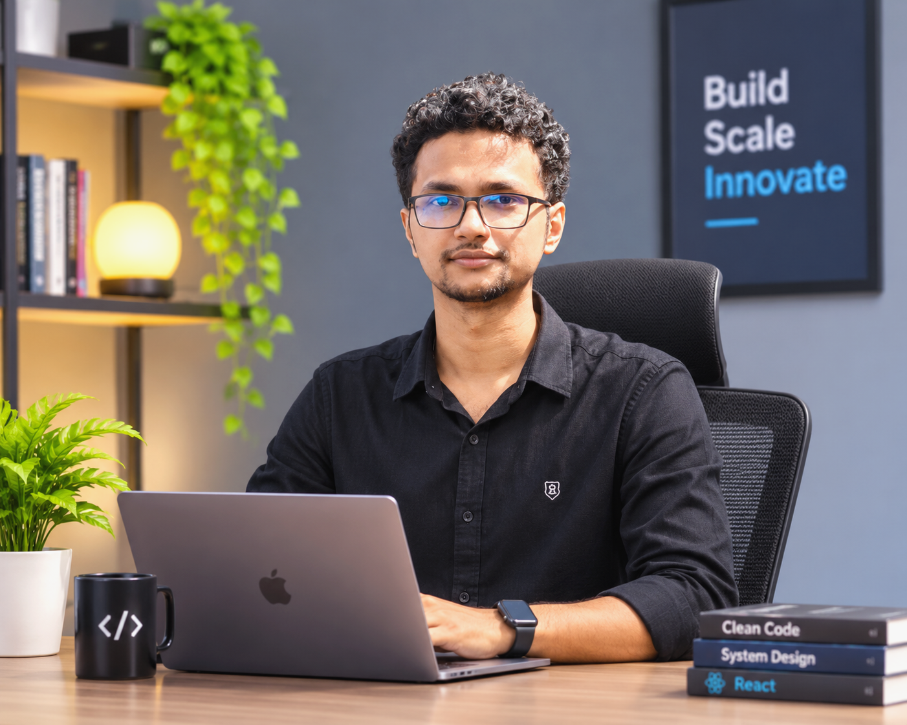

<table>
  <tr>
    <td width="60%" valign="middle">
      <h1>Mynul Islam</h1>
      
<strong>Full Stack &amp; Backend Software Engineer</strong> · <a href="https://cansoft.com/">Cansoft Technology</a>

      
2+ Years Production Experience · Remote (Bangladesh, UTC+6)

      

        I build revenue-ready <strong>multi-tenant SaaS platforms</strong>, high-throughput <strong>REST / GraphQL / tRPC APIs</strong>, asynchronous job queues (<strong>Redis &amp; BullMQ</strong>), and practical <strong>AI/LLM workflows</strong> using TypeScript, Node.js, Next.js, and PostgreSQL.
      

      

        
        
        
      

    </td>
    <td width="40%" align="center" valign="middle">
      
    </td>
  </tr>
</table>

---

### How I Deliver Value

- **Product & Revenue Delivery (CEO):** Ship production multi-tenant SaaS platforms ([emmai.ca](https://emmai.ca)), full-stack web apps, and practical AI/LLM features end-to-end.
- **Performance, Cost & Risk Control (CFO):** Optimize API latency (40%+ gains), offload heavy workloads via Redis/BullMQ queues, and build HIPAA/PIPEDA-ready audit trails & Stripe billing.
- **Scalable Architecture & Quality (CTO):** Type-safe TypeScript, Node.js, Next.js, and PostgreSQL systems with granular RBAC (`CASL`), Docker/CI-CD, and automated Playwright/Jest testing.

---

### Featured Production & Published Work

| Project | Stack | Highlights | Links |
| :--- | :--- | :--- | :--- |
| **Emmai — Clinic Booking SaaS** | Node.js, TypeScript, PostgreSQL, Redis, BullMQ, Next.js, CASL | Multi-tenant clinic SaaS, RBAC, Google Calendar/iCal sync, telehealth & Stripe billing | [Live](https://emmai.ca) · [Demo](https://abc.emmai.ca) |
| **DevTools Hub** | Next.js, React, TypeScript, Tailwind CSS | Client-side developer suite: JSON Formatter, Image Editor, Font Picker, Markdown-to-LinkedIn | [Live](https://devtools-hub-navy.vercel.app/) · [Repo](https://github.com/Mynul-Sakil/Dev-Tools-2) |
| **AI Task Organizer** | React 19, TypeScript, Vite, Express, Zod, Gemini API | Full-stack AI task prioritizer with strict JSON prompting & resilient fallback sorting | [Live](https://ai-task-organizer-psi.vercel.app/) · [Repo](https://github.com/Mynul-Sakil/ai-task-organizer) |
| **System 3.0** | Next.js, TypeScript, tRPC, Zod, MongoDB | End-to-end type-safe gamified habit engine with stat progression & leaderboards | [Live](https://system-3-6czj.vercel.app/) |
| **GQLAB (TMS)** | Next.js, TypeScript, Node.js, GraphQL, PostgreSQL | Enterprise transportation management system with GraphQL APIs & cursor pagination | [Live](https://gqlab.vercel.app/) · [Repo](https://github.com/Mynul-Sakil/GQLAB) |
| **Antigravity Skills** | Bash, Python, Markdown | Open-source AI agent skills library & selective CLI installer for Antigravity, Claude Code & Copilot | [Repo](https://github.com/Mynul-Sakil/antigravity-skills) |
| **Tap Kill** | Kotlin, Android SDK 36, Gradle | Native Android arcade game with wave mechanics, haptic feedback & zero-tracking privacy | Android *(Early Access)* |

---

### Technical Stack

| Layer | Technologies |
| :--- | :--- |
| **Languages** |        |
| **Backend & Data** |             |
| **Frontend & Mobile** |        |
| **DevOps, QA & AI** |        |

---

### Experience

- **AI Full Stack Developer / Backend Engineer** · [Cansoft Technology](https://cansoft.com/) *(Remote · Apr 2026 – Present)*
  Architected multi-tenant clinic SaaS ([emmai.ca](https://emmai.ca)) with Node.js, TypeScript, PostgreSQL (Supabase), Redis/BullMQ queues, CASL RBAC, Google OAuth & `.ics` calendar sync, and PostgreSQL audit triggers.
- **Full Stack / Backend Developer** · Aliyah Holdings LLC *(Remote · Aug 2024 – Apr 2026)*
  Built scalable React, Next.js, and Node.js platforms (including 70Languages.com & BargainBunny) with Socket.io real-time chat, Redis caching, Stripe webhooks, and ChatGPT/Google Translate integrations.
- **Full Stack Developer Intern** · Rapid Proposal LLC *(Remote · Mar 2022 – Jul 2023)*
  Optimized Express.js REST APIs (40% performance improvement) and built a React admin panel for daily transaction management.

---

### Education, Credentials & Problem Solving

- **B.Sc. in Computer Science** — Manarat International University (`2020 – 2024`, **GPA: 3.8/4.0**)
- **Complete Web Development** — Programming Hero Certified Web Developer (`2023`)
- **FinTech & AI Tooling** — Built custom equity research & fundamental analysis workflows for the Dhaka Stock Exchange (DSE)

  
  
  

---

### GitHub Activity

  <picture>
    <source media="(prefers-color-scheme: dark)" srcset="https://github-readme-streak-stats.herokuapp.com/?user=Mynul-Sakil&theme=github-dark-blue&background=0D1117&border=30363D&ring=58A6FF&fire=58A6FF&currStreakLabel=58A6FF&disable_animations=true" />
    <source media="(prefers-color-scheme: light)" srcset="https://github-readme-streak-stats.herokuapp.com/?user=Mynul-Sakil&theme=default&background=FFFFFF&border=D0D7DE&ring=1D4ED8&fire=1D4ED8&currStreakLabel=1D4ED8&disable_animations=true" />
    
  </picture>

